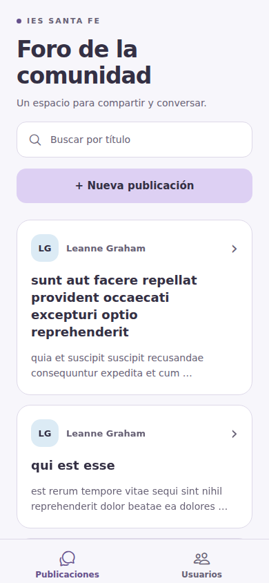
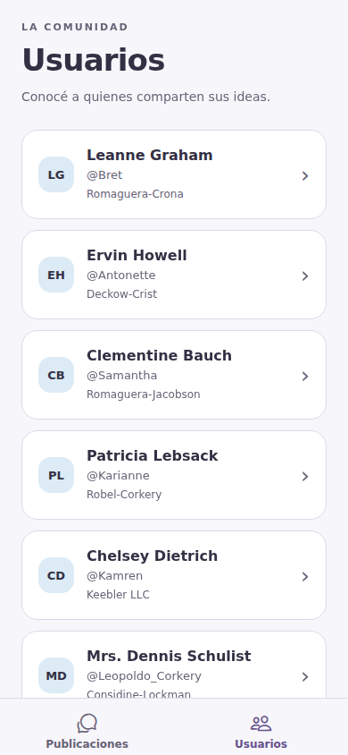
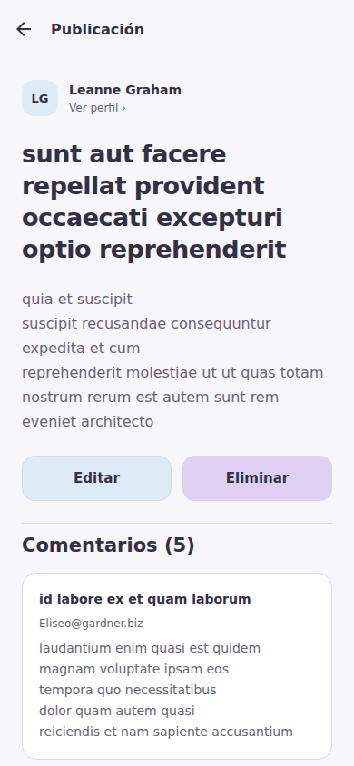
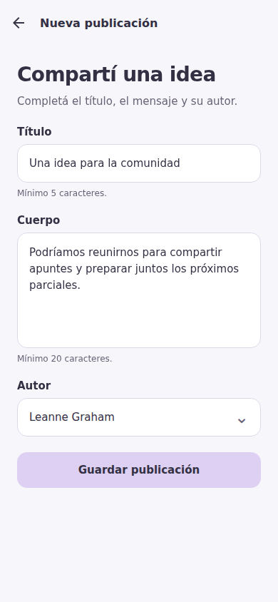
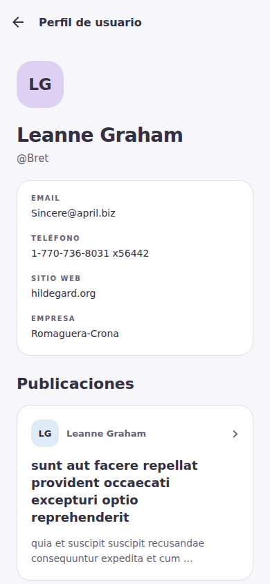

# Foro de la comunidad

IES Santa Fe N.º 9233 · Ingeniería de Software II · Trabajo Práctico Final, Unidad 5, Propuesta 1.

Aplicación móvil hecha con Expo, Expo Router y TypeScript. Consume JSONPlaceholder y mantiene las altas, ediciones y bajas en memoria durante la sesión.

## Integrantes

- Integrante 1: Eric Xuan Cabral.
- Integrante 2: Lucas Lazzarotto.
- Integrante 3: Matias Martinez.
- Integrante 4: Federico Teves.

Estos datos quedan pendientes porque no fueron proporcionados. La consigna pide un grupo de dos o tres personas.

## Cómo ejecutar

Requisitos: Node.js 24 LTS, npm, conexión a internet y Expo Go compatible con SDK 57 en el celular. Se eligió SDK 57 siguiendo la indicación de Expo para usar Expo Go en dispositivos físicos durante la transición a SDK 58.

Desde la carpeta `foro-comunidad`:

```bash
npm ci
npm start
```

Conectá la computadora y el celular a la misma red y abrí el QR con Expo Go. Si la red impide conectarlos, se puede iniciar con `npx expo start --tunnel`.

Para revisar la versión web:

```bash
npm run web
```

No se necesita crear cuentas, configurar claves ni ejecutar un backend propio.

## Qué permite hacer

1. **Feed:** ver título, extracto de dos líneas y autor; buscar por título sobre la lista ya cargada; abrir una publicación o crear una nueva.
2. **Usuarios:** ver nombre, @username y empresa; abrir el perfil.
3. **Detalle:** leer el cuerpo completo, abrir el autor, consultar los comentarios y su cantidad, editar y eliminar con confirmación.
4. **Alta / edición:** usar el mismo formulario para título, cuerpo y selector de autor. Valida campos obligatorios, título de cinco caracteres, cuerpo de veinte y un ID de autor entero positivo presente en la lista. Los mínimos se aplican después de quitar espacios de los extremos.
5. **Perfil:** ver nombre, email, teléfono, sitio web, empresa y publicaciones que abren su detalle.

No se implementó ninguno de los cuatro extras: crear comentarios, pull-to-refresh, filtro por autor ni cantidad de publicaciones en la pestaña Usuarios.

## Capturas

Capturas de la aplicación ejecutándose en Chromium con un viewport móvil de 390 × 844. Son capturas de ejecución web, no de un teléfono físico.

| Feed | Usuarios |
| --- | --- |
|  |  |

| Detalle | Alta / edición |
| --- | --- |
|  |  |

| Perfil |
| --- |
|  |

## Estructura

`src/app/` contiene las rutas: `(tabs)` agrupa Feed y Usuarios; el Stack abre detalle, formularios y perfil. Los parámetros se leen con `useLocalSearchParams` y sólo se pasa el ID por la URL.

`types/` define las tres entidades según respuestas reales; `services/` concentra las operaciones HTTP; `context/` conserva las publicaciones y sus cambios durante la sesión.

`components/` reúne tarjeta, formulario, selector y estados reutilizables con props tipadas; `validaciones/`, `hooks/` y `utils/` contienen las funciones compartidas. Todos los colores viven en `constants/colores.ts` y los estilos se definen con `StyleSheet.create`.

Las carpetas mencionadas están dentro de `src/`, como establece la plantilla actual de Expo. `tests/` contiene las pruebas de servicios, validación y consistencia.


## Uso de IA

**Herramienta:** ChatGPT / Codex, para revisar la consigna, generar y corregir código y documentación, consultar documentación oficial y ejecutar verificaciones. No se atribuye este desarrollo automático a los integrantes.

**Prompts e instrucciones principales:** los dos primeros resumen pedidos del usuario; los otros tres resumen las subtareas técnicas que guiaron el trabajo de Codex durante esta misma asistencia, no mensajes adicionales enviados por el grupo.

| Origen | Instrucción |
| --- | --- |
| Usuario | Realizar el proyecto con lo justo y necesario, seguir las recomendaciones del documento, evitar los errores enumerados y usar la paleta adjunta. |
| Usuario, aclaración | No implementar lo expresado como extras y consultar si aparecen dudas. |
| Subtarea de Codex | Consultar las respuestas reales y la documentación de Expo antes de definir tipos y configurar la navegación. |
| Subtarea de Codex | Mantener el CRUD consistente con Context, resolver autores con un mapa y asignar IDs locales únicos sin consultar recursos creados en la sesión. |
| Subtarea de Codex | Verificar los límites del formulario, las escrituras y los errores; revisar TypeScript, lint, compilación y navegación; obtener las capturas. |

**Dos errores reales de la primera implementación de IA y su corrección:**

1. Se propuso `StyleSheet.absoluteFillObject` para el fondo tocable del selector. TypeScript informó que esa propiedad ya no existe en React Native 0.86. Se reemplazó por `position`, `top`, `right`, `bottom` y `left` dentro de `StyleSheet.create`; la comprobación de tipos pasó.
2. En detalle y perfil se reiniciaban estados de carga y error directamente dentro de `useEffect`. El lint actual señaló renderizados en cascada. Se reemplazó por un resultado asociado a la ruta y al intento actual: la carga se deriva de esa clave y el estado sólo cambia al resolverse o fallar el pedido. El lint pasó y una respuesta vieja no reemplaza la ruta actual.

Cada integrante debe revisar y poder explicar todos los archivos. La generación con IA y las verificaciones automáticas no reemplazan la defensa individual.

## Verificación

```bash
npm run typecheck
npm run lint
npm test
```

Se verificaron los tipos, el lint y diez pruebas automatizadas: endpoints y métodos; rechazo de HTTP fallidos; fallo de red; IDs sin duplicados; consistencia ante recarga tardía; cambio de autor en perfiles; edición y baja local; límites de largos; campos vacíos; y autores inválidos.

También se exportaron correctamente los paquetes de JavaScript/Hermes para Android e iOS y la versión web. Esa exportación no es un APK ni una instalación en el teléfono.

En Chromium se aprobaron once escenarios de interfaz con la API real y cortes de red controlados: navegación, búsqueda sin pedidos nuevos, formulario precargado, PUT y cambio de autor, confirmación de DELETE, validaciones, bloqueo de Guardar durante el envío, dos altas con IDs únicos, CRUD local sin pedidos por esos IDs, errores de carga con reintento y recuperación de un POST fallido. No se detectaron errores de JavaScript durante ese recorrido. Las cinco capturas corresponden a esta ejecución.


## Referencias

- [Consigna de la API y guía](https://jsonplaceholder.typicode.com/guide/).
- [Creación del proyecto y compatibilidad con Expo Go](https://docs.expo.dev/get-started/create-a-project/).
- [Expo SDK 57](https://docs.expo.dev/versions/v57.0.0/).
- [Tabs de Expo Router](https://docs.expo.dev/router/advanced/tabs/).
- [Stack de Expo Router](https://docs.expo.dev/router/advanced/stack/).
